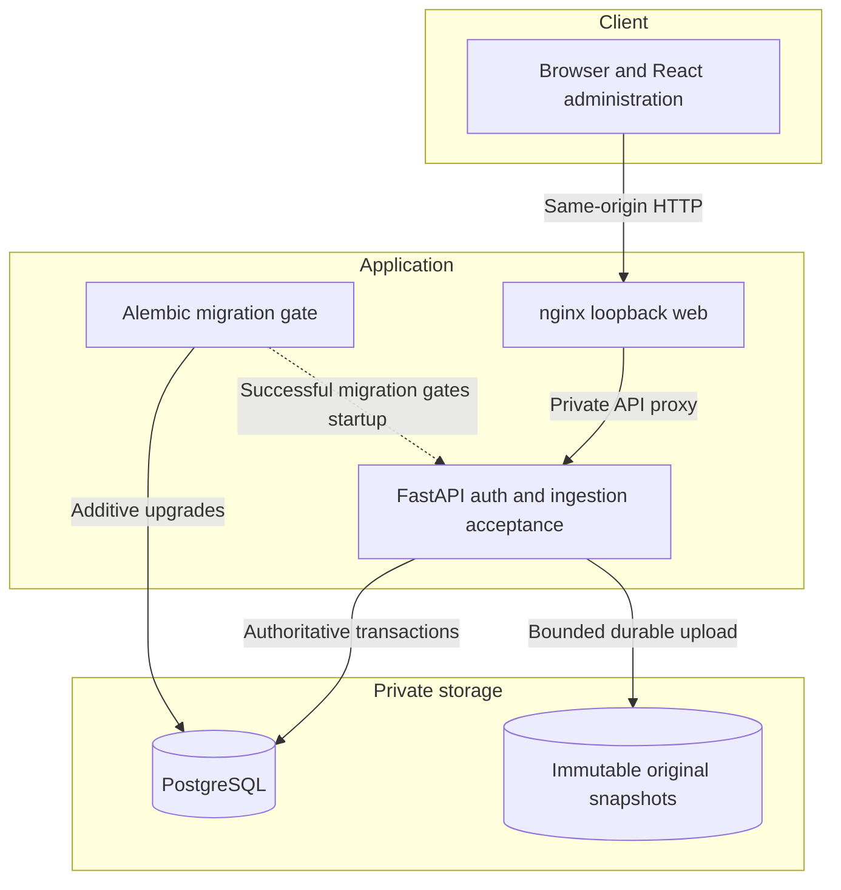
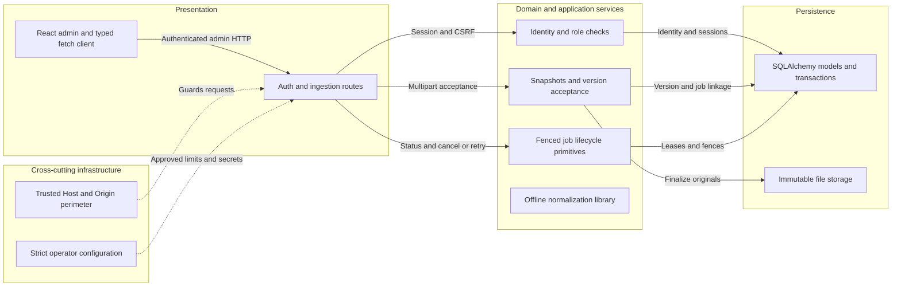

# Architecture Diagram

Historical view of stage-one administration and stage-two manual ingestion
acceptance. Automatic filesystem ingestion and local vector indexing were added
after this snapshot; see the [current runtime](../../../../../README.md).
The editable [draw.io diagram](../../../../../Architecture.drawio) adds a third
page for the full target RAG architecture; query generation is not operational yet.

## Application Architecture

<!-- mermaid-checked: no \n, no em-dash/en-dash, no {} in labels, subgraphs are id["label"], arrows are -->|"label"|, all subgraphs closed by end, ids unique -->

### Technology Stack Summary

| Layer | Technology | Version | Purpose |
|---|---|---|---|
| UI | React / TypeScript | 19.2.0 / 5.9.3 | Admin sessions, users and source configuration |
| Web | nginx | Image 1.28.0 | Loopback exposure, CSP, internal API proxy |
| API | Python / FastAPI / Pydantic | Python 3.12; manifest-constrained packages | Authentication and bounded manual ingestion |
| Persistence | SQLAlchemy / Alembic | 2.0 / manifest-constrained Alembic | Transactions and migrations 0001/0002 |
| Store | PostgreSQL | Compose image 16.6 | Identity, inventory configuration, versions, durable jobs |
| Artifacts | Private filesystem volume | Not applicable | Immutable originals before DB reference commit |

### Data Storage & External Services

PostgreSQL is authoritative; snapshots live in a private volume. Both Compose
networks are internal. No external model provider, Qdrant, Ollama, LangGraph,
LangSmith or watcher process is connected in this increment. Docker runtime
certification remains pending; code and PostgreSQL behavior have been tested.

### Key Architectural Decisions

- Shared Python backend image supplies API, bootstrap and migration commands.
- Upload acceptance commits immutable bytes and durable linkage, not publication.
- Auth, tenant, role, CSRF and lifecycle decisions remain server-side.

## Component Relationships

<!-- mermaid-checked: no \n, no em-dash/en-dash, no {} in labels, subgraphs are id["label"], arrows are -->|"label"|, all subgraphs closed by end, ids unique -->

### Component Inventory

| Component | Layer | Type | Responsibility |
|---|---|---|---|
| React admin | Presentation | UI | Login, users and approved source configuration |
| API routes | Presentation | FastAPI routers | Authenticated HTTP DTOs, bounded multipart acceptance |
| Identity | Business | Domain-backed service | Argon2id, session hashes, current roles, revocation |
| Documents | Business | Service | Private snapshots, revisions, idempotency, backpressure |
| Jobs | Business | Queue primitives | SKIP LOCKED claims, database time, heartbeat/fencing |
| Normalization | Business | Library, not wired to worker | Format parsing and typed locations; sandbox still needed |
| SQLAlchemy models | Persistence | Data adapter | Tenant-scoped identity/document/job storage |
| Snapshot files | Persistence | Filesystem adapter | Immutable original bytes and durable finalization |
| Perimeter | Infrastructure | Middleware | Host/Origin, bounded bodies and explicit error responses |
| Configuration | Infrastructure | Strict Pydantic model | Local-only policy, private storage and secret references |

No worker loop consumes the normalization library or queue yet. Planned query
and automatic ingestion relationships are explicitly dashed on draw.io page 3.
