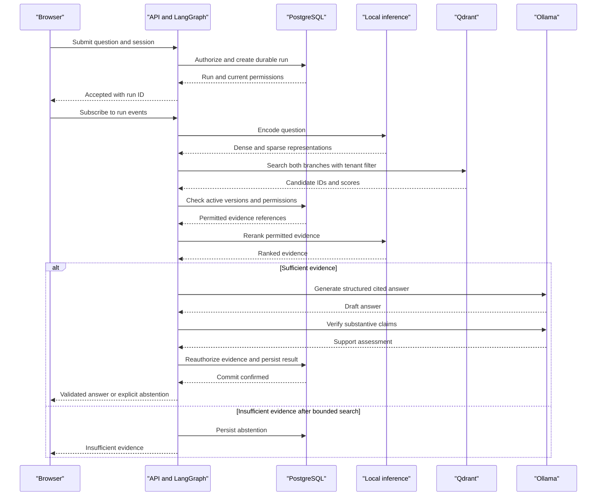

# Low-Level Design: Configurable Self-hosted Knowledge Assistant

Status: implementation specification; no application, Compose deployment, or
benchmark is delivered by this document.

Implementation context: [contract index](./docs/README.md). The indexed data,
security, ingestion, and OpenAPI contracts are authoritative; tables/examples
below are explanatory snapshots, not competing specifications.

Architecture and scope: [HLD](./HLD.md).

Editable diagrams: [LLD flows](./LLD.drawio), with generalized Ingestion, Authorized
Query, NAS/RBAC specialization and Product Configuration pages. Open with the draw.io VS Code extension or a local
diagrams.net Desktop installation; PNG/SVG export is available in the editor.

## 1. Proposed source structure

Product scope is governed by [ADR 0002](./docs/decisions/0002-configurable-production-product.md).
Use [connector/parser contracts](./docs/connectors-formats.md),
[provider/export/cost contracts](./docs/models-cost-performance.md), and
[Compose/Helm packaging](./docs/deployment-packaging.md). The NAS/local-PDF
protocols below are default specializations, not a ban on configured sources,
formats, providers or shared production storage.

```text
backend/
  app/
    api/                 # HTTP endpoints, sessions, SSE
    domain/              # Authorization, lifecycle, typed contracts
    ingestion/           # Parsing, normalization, quality checks, chunking
    sources/             # NAS polling, stable snapshots, source reconciliation
    providers/           # Local/paid capabilities, export gates, budget accounting
    retrieval/           # Filter construction, fusion, evidence selection
    graph/               # LangGraph state, nodes, routing, checkpoints
    storage/             # PostgreSQL, artifacts, Qdrant adapters
    jobs/                # Leases, handlers, maintenance
    evaluation/          # Local datasets, runners, scoring
    settings.py
  migrations/
  tests/
inference/
  app/                   # Shared local embedding/sparse/reranking service
frontend/
deploy/
  compose.yaml
  compose.nvidia.yaml
  Dockerfile.backend
  Dockerfile.inference
  Dockerfile.web
  proxy.conf
  env.example
  helm/                  # Same images/contracts; versioned values and schema
scripts/
  prepare_models.py
  ingest_directory.py
  backup.sh
  restore.sh
```

These paths are planned, not existing deliverables. Batch ingestion calls the
same application ingestion service as HTTP uploads; it must not bypass ACL,
versioning, validation, or job creation.

The `watcher` command runs separately from the parser worker. It uses this same
ingestion service with a narrowly scoped noninteractive source identity, not a
stored human password/session.

## 2. Runtime/service contracts

| Caller | Callee | Contract | Initial deadline |
|---|---|---|---|
| Browser | API through web | Same-origin JSON REST and SSE | 180 s chat; 10 s ordinary requests |
| API/worker | PostgreSQL | SQL transactions, parameterized queries | 5 s ordinary statement; explicit maintenance overrides |
| API/worker | Qdrant | Filtered query/upsert/delete with completion checks | 10 s/query; 30 s/write batch |
| API/worker | Inference | Internal HTTP JSON | 30 s online operation; 120 s ingest batch |
| API | Ollama | Local chat with structured response | 120 s within total run budget |
| Worker | Parser subprocess | File input and structured artifacts | 10 min/document initially |

All values are initial configuration, to be benchmarked on the host. A chat run
has a 150 s overall deadline, including model queue wait. Timeouts cancel work
where supported and return a typed error; never substitute a cloud provider.
Configured paid calls stay on their approved provider/profile under the same
deadline. No implicit local-to-paid failover. Atomic shared budget reservations
precede remote calls across API/worker replicas.
The proxy allows at least 180 s and disables SSE buffering.

Retry only transient transport failures, 429/503 responses, or explicitly
retryable database conflicts. Allow at most two retries with jittered backoff
(roughly 0.5 s, then 2 s), bounded by the overall deadline. Never automatically
replay an uncertain generation POST; persist its run ID and inspect status.

After five consecutive local dependency failures, open that dependency's
process-local circuit for 30 s, then allow one half-open probe. This is separate
from an evidence-based abstention.

## 3. Persistence model

Use UUID primary keys and UTC timestamps. All company-scoped rows have
`tenant_id`; composite keys/foreign keys prevent cross-tenant references.
Start with one configured company tenant, not a full tenant-provisioning product.

| Table | Principal fields and invariants |
|---|---|
| `tenants` | `id`, `name`, `acl_revision`; revision increments with authorization changes |
| `users` | `id`, `tenant_id`, `username`, `password_hash`, `role`, `disabled_at`; tenant-unique username |
| `sessions` | Hash of random session token, `user_id`, expiry, CSRF secret, revocation time |
| `documents` | `id`, tenant, title, `active_version_id`, `active_generation_id`, lifecycle status, ACL revision |
| `sources` | Tenant, discriminated connector config, formats, export flags, enabled state, revision, scan policy and health; secret refs only |
| `source_scans` | Source, scan ID, start/end, complete/healthy flags, error, observed count, deletion circuit status |
| `source_files` | Source, normalized relative path, document ID, desired revision, observed size/mtime/hash, last-seen complete scan, stable-since, missing-since/count, tombstone state; source/path unique |
| `source_observations` | Scan/file observations including read/stat errors; support safe reconciliation and audits |
| `document_versions` | ID, document, sequence, source hash, format/MIME, bytes, optional PDF pages, artifact root, parser revision, status, quality |
| `index_generations` | `id`, version, collection name, model/pipeline fingerprints, expected chunk count, status |
| `chunks` | ID, tenant, document/version/generation, ordinal, text artifact locator, heading path, token count, text hash, provenance JSON |
| `jobs` | ID, tenant, kind, payload, status, attempts, `available_at`, lease owner/expiry, fencing token, heartbeat, sanitized error |
| `conversations` | ID, tenant, owner, title, expiry |
| `messages` | ID, conversation, role, content, status, evidence manifest, model/prompt revisions |
| `query_runs` | ID, tenant, conversation, requester, idempotency key, status, deadline, authorization revision, error code |
| `run_events` | Run ID, increasing sequence, event type, safe payload, creation time |
| `feedback` | User, assistant message, rating, optional local comment |
| `audit_events` | Actor, action, resource ID, timestamp, outcome, request ID; no document text |

Additional canonical entities: source cursors, deployment-imported model profiles/
policy, price catalog, budget windows, cost reservations, usage records and
safe artifact caches; field/constraint ownership is in
[data model](./docs/data-model.md), not duplicated here.

Create indexes for ready jobs, expired leases, tenant/document lifecycle,
conversation ownership, and source/path inventory. Job payloads contain identifiers,
not PDF bodies. Foreign-key and uniqueness constraints enforce generation/chunk
identity and idempotency.

Use the supported PostgreSQL LangGraph checkpointer in its own schema. Application
authorization still gates every thread load; knowing a thread ID is not a grant.
Raw retrieved text is transient graph state where possible; persist evidence IDs
and rehydrate only after authorization. Apply retention to checkpoints as well
as messages. Encrypt the host/backup stores that contain this sensitive state.

### Filesystem layout

```text
/data/tenants/<tenant_id>/documents/<document_id>/
  versions/<version_id>/
    original.<format-extension>
    document.md
    docling.json
    blocks.jsonl
    quality.json
    generations/<generation_id>/chunks.jsonl
```

Paths are server-generated; uploaded filenames are display metadata only.
Use temporary files plus atomic rename. Mark artifacts committed in PostgreSQL
only after durable writes. Sweep unreferenced temporary files after a grace period.
API needs controlled write access for uploads and read access for citations;
worker writes derivatives. Model caches are read-only after preparation.
Retain existing `source.pdf` snapshots where already recorded. On K8s use shared
RWX PVC or private object artifact storage; never depend on per-node local copies.

## 4. Ingestion state machine

### Filesystem/NAS watcher specialization

The filesystem source can be local or host/CSI-mounted SMB/NFS. Map a preconfigured
mount into `watcher` as read-only `/sources/company-pdfs`. API, parser, inference,
and database containers have no NAS mount. Watcher alone writes snapshots into
the shared artifact volume. Do not mount shares inside privileged containers.

Only an administrator can enable configured source aliases; the API does not
accept arbitrary filesystem paths, SMB URLs, or credentials. A source must refer
to a preapproved tenant-wide corpus: every authenticated user in that tenant can
read its published content. App roles do not mirror SMB ACLs. Restrict NAS writer
access separately because source content can influence answers.

Discovery protocol:

1. Acquire a renewable per-source scan lease/fencing token; only one complete
   reconciliation may update absence counters for that source at a time.
2. Verify the expected share sentinel UUID, root readability, and a fresh host
   mount-health check. The host checks expected SMB server/share identity and
   performs an uncached probe; container `exists()` alone is insufficient.
   Health records expire after 60 seconds. Missing/stale/failed health records
   pause discovery reconciliation and deletion, not silently report an empty root.
3. Recursively poll PDFs every 30 seconds without overlapping scans. Skip symlinks,
   path escapes, nonregular files, and temporary/partial names. A listing/stat/
   permission error makes the entire deletion reconciliation incomplete; report
   the error and retain prior inventory. Enforce file-count/depth/time budgets.
4. Record observations durably. A path is eligible when size and mtime remain
   unchanged in at least three observations spanning 60 seconds, and a producer
   completion marker/manifest is present when configured.
5. A leased snapshot job stream-copies bytes with SHA-256 into a local temporary
   file, checks byte count and pre/post source metadata, and    validates the selected format.
   Enforce the same byte/page/time limits as uploads. Changed-during-copy files
   return to stability observation and are not indexed.
6. Without an explicit producer completion protocol, require a second independent
   source hash after the stability interval before publishing. Report this as a
   heuristic: a paused producer can still fool it. Prefer atomic final rename or
   ready manifests; verify declared hashes if supplied.
7. Finalize the local snapshot with atomic rename. In one DB transaction, verify
   scan/snapshot lease, source enabled state, source desired revision, and document
   lifecycle; create the version, ingestion job, and source observation linkage.
8. Deduplicate using source/file desired revision and content hash, including
   pending versions; identical content updates only observation metadata. A later
   replacement is not allowed to be overwritten by an older snapshot/worker.

Use source ID plus normalized relative path as source identity, respecting the
configured share's case semantics. Do not lowercase every path blindly. A new
path creates a new document even if the bytes match another file. Same-path
replacements version the same document. Scheduled full content-hash reconciliation
(initially daily) detects same-size/same-mtime changes. File notifications may
accelerate a scan but are not authoritative over SMB.

Deletion protocol:

- Advance missing counters only on complete, healthy scans with fresh positive
  mount identity/health checks before and after traversal.
- Require three such absences spanning at least five minutes plus a direct final
  lookup returning confirmed not-found under a healthy mount.
- Timeouts, permission errors, and root/sentinel failures are not not-found.
  Reset absence confirmation across outages; reestablish healthy evidence.
- Freeze automatic withdrawal if a scan would remove over 20% of tracked files,
  or empties a nonempty corpus. Require admin review and a fresh healthy rescan;
  approving an alert never overrides failed mount-health checks.
- Lock the source-file/document rows and recheck desired revision before marking
  `SOURCE_DELETED`, incrementing its revision, and canceling older pending work.
  PostgreSQL withdrawal gates retrieval/downloads immediately; enqueue cleanup.
- A reappearing path creates a new desired revision and reingests before becoming
  available. Do not republish a stale job or resurrect deleted derived answers.

Disabling a source pauses discovery but does not mean its files were deleted.
Manual admin suppression persists across scans until an explicit admin restore
action. A curator's rescan cannot clear suppression. UI editing/replacing source-managed PDFs is rejected with 409; update
their NAS source instead. Manual uploads remain independent of NAS deletion.

Scanner health, last successful complete scan, backlog, and content freshness are
visible to curator/admin users. Readers get a general stale-source warning during
outages; queries continue against the last committed active corpus.

```text
RECEIVED -> VALIDATING -> EXTRACTING -> QUALITY_CHECK -> CHUNKING
    -> EMBEDDING -> INDEXING -> VERIFYING -> READY

QUALITY_CHECK -> REVIEW_REQUIRED
Any processing state -> FAILED
Any nonterminal state -> CANCEL_REQUESTED -> CANCELLED
```

Job state is separate: `PENDING -> RUNNING -> SUCCEEDED`, with `RETRY_WAIT`,
`FAILED`, and `CANCELLED`. Record a safe error code and actionable explanation.
Do not silently skip failed pages.

### Upload and version rules

- Initial limits: 100 MiB/PDF and 1,000 pages; configurable after measurement.
- Verify PDF signature and parser validity, not only extension/MIME.
- Stream uploads; enforce actual bytes received, available disk, and request time.
- Reject encrypted PDFs with `PDF_ENCRYPTED`; password handling is out of scope.
- New manual document upload and explicit replacement are separate operations;
  both require curator/admin permissions. Source-managed versions use the watcher.
- A repeated idempotency key with identical request metadata returns the original
  resource; conflicting content returns 409.
- Content-hash reuse stays inside an authorized document scope. Do not expose a
  global hash-existence endpoint that reveals another document's presence.
- Limit parser subprocess CPU/memory/time; no network, no root, no Docker socket.
- Suspicious/malformed files fail closed and remain unavailable to readers.

### Durable queue algorithm

1. Insert the version and job in one PostgreSQL transaction after upload finalization.
2. Claim one eligible job using `FOR UPDATE SKIP LOCKED`.
3. Increment its fencing token, set a 120 s lease, then commit the claim.
4. Renew every 20 s while work continues; parsing cannot block the heartbeat.
5. Every committed stage/publication checks owner, token, lease, and cancellation.
6. After lease expiry, recovery can requeue the job. A stale worker cannot publish.
7. Allow three total job attempts for transient faults; permanent extraction or
   validation errors go directly to failure/review.

Writes use attempt-specific staging generations/artifacts so an expired worker
cannot corrupt a replacement attempt. Deterministic point IDs make a retry within
one owned generation idempotent. Cleanup ignores any live leased attempt.

### Extraction and quality checks

Normalize parser output into blocks containing text, block kind, heading path,
PDF page index (one-based), bounding boxes where available, and extraction method.
Keep printed page labels separately from PDF physical page indices.

Flag pages with no/very little extracted text unless explicitly classified blank.
Flag missing provenance, OCR failures, truncated extraction, and suspicious table
structure. A review report includes affected pages. Reviewer acceptance is audited
and does not invent provenance. Unmapped content cannot produce page citations.

Render Markdown from these blocks. Never reconstruct provenance by guessing where
plain Markdown text appeared in the source.

### Chunking

- Begin at 450 tokens plus the heading prefix; hard cap at 480 for the initial
  512-token embedding candidate, reserving room for special/query instructions.
- Verify actual tokenizer limits for every pinned model; reject silent truncation.
- Use paragraph/heading boundaries and up to 60 tokens overlap for split sections.
- Preserve every contributing block's source pages and optional bounding boxes.
- Repeat table headers when splitting row groups; flag a row that exceeds budget.
- Keep original text for quotations; normalize only the retrieval representation.
- Hash normalized text plus pipeline revision for reproducibility.

The final chunk budget must also respect the reranker's query-plus-passage limit.
Long questions reduce the passage budget or use explicit sliding-window scoring;
the service never silently truncates away evidence.

## 5. Qdrant index specification

Dense embeddings default local but can be externally configured with source/
requester approval and spend reservation. Sparse/reranking remain local. Pin
one active corpus embedding profile; stage a full reindex and routing promotion
when changing it. Never silently encode queries with a different model/dimension.

One collection per embedding/pipeline fingerprint, shared across tenants with
mandatory tenant filters. The initial collection has:

| Element | Specification |
|---|---|
| Point ID | UUID derived from tenant, version, generation, and chunk ordinal |
| `dense` vector | 768 dimensions and cosine distance for the initial candidate |
| `sparse` vector | Local BM25 sparse encoding using a pinned vocabulary/tokenizer |
| Payload | Tenant/document/version/generation IDs, ordinal, section metadata |
| Payload indexes | Keyword indexes on tenant, document, and generation IDs |
| Text handling | Do not return text from Qdrant; resolve authorized chunk artifacts |

Use one validated BM25 sparse integration for both corpus and queries; persist its
model/vocabulary/configuration fingerprint and use Qdrant's supported IDF settings
where required. Do not mix independent encoders or vocabulary assignments.
Do not assume every server feature is exposed by the chosen LangChain adapter:
use the typed Qdrant client inside the shared retrieval adapter where necessary.

### Retrieval

1. Enforce `query` permission; build the server-side tenant equality filter.
2. Apply it independently to dense and sparse prefetch queries.
3. Retrieve 40 candidates per branch and fuse with RRF, returning 50 IDs.
4. Verify active document/version/generation and authorization in PostgreSQL.
5. If stale candidates reduce coverage, fetch a larger bounded pool, at most
   200 IDs/branch; never remove authorization filters to improve recall.
6. Load permitted text, locally rerank up to 50 valid candidates, select up to
   eight nonredundant chunks within the generation context budget.

Initial retrieval parameters are tuning defaults. The selected model's tokenizer
counts system prompt, conversation history, question, evidence, and output reserve.
Start with an 8,192-token context only if the selected model and host support it;
reserve roughly 1,024 output tokens. Trim history/evidence explicitly, not silently.

### Publishing and replacing a generation

Qdrant and PostgreSQL do not share a transaction.

1. Upsert all points into a new generation and wait for write completion.
2. Verify expected IDs/count and vector/model metadata.
3. Lock the document row in PostgreSQL; verify latest intended version, lease,
   cancellation, deletion, authorization revision, and source desired revision.
4. If authorization/source state changed during indexing, reauthorize publication
   or discard the staged generation. Source-deleted/suppressed documents cannot publish.
5. Atomically update the document's active version/generation pointer.
6. Mark the old generation retired; clean it asynchronously.

New points may be discoverable before activation, but canonical PostgreSQL checks
exclude them. Old active content remains usable if staging fails.
Superseded uploads cannot publish over a newer intended replacement.

## 6. Authorization, sessions, and lifecycle

RBAC uses a fixed role enum on each user: `reader`, `curator`, or `admin`.
Implement a central permission map and `require_permission(...)` dependency for
every protected API and domain entry point; UI visibility is not enforcement.
Permissions are inherited explicitly as follows:

| Action | reader | curator | admin |
|---|---|---|---|
| Query and read all active tenant documents/PDFs | Yes | Yes | Yes |
| Own conversations and own feedback | Yes | Yes | Yes |
| Manual upload/replace; inspect jobs; review/retry/cancel ingestion | No | Yes | Yes |
| Read scan health; request non-destructive rescan | No | Yes | Yes |
| Create/disable users, reset passwords, change roles | No | No | Yes |
| Configure/pause sources; approve mass-deletion reconciliation | No | No | Yes |
| Withdraw/suppress/restore documents | No | No | Yes |
| Approve source/manual-document model export; inspect model policy/usage | No | No | Yes |

Unknown roles/permissions deny access. Authentication and role checks are
server-side on every request and at run finalization. All roles read the same
active tenant corpus by the selected policy; per-document groups and NAS ACL
mirroring are out of scope. Ownership restrictions still apply to conversations,
events, and feedback, including for admins. Anonymous access is limited to login
and minimal liveness.

The watcher service identity can observe its configured source, stage snapshots,
enqueue work, and reconcile source lifecycle. It cannot log in, change roles, or
query chat. Use least-privilege DB credentials; do not model it as a human admin.

Provision the first admin with an explicit one-shot command and secret input;
no default credentials. Use Argon2id hashes and maintained authentication helpers.
Sessions use random opaque tokens stored hashed, 8-hour absolute expiry, HttpOnly
cookies, SameSite protection, CSRF checks on mutations, and logout/revocation.
Use Secure cookies under TLS; the loopback HTTP profile explicitly documents its
development-only exception. Enforce origin/host checks and no wildcard CORS.

Initial login throttle: five failures/account per 15 min plus an IP rate limit.
Return a generic authentication error; audit without passwords or session tokens.

The existing `acl_revision` fields are authorization/lifecycle revisions, not
document-group grants. Increment them on role/account status or document
availability changes. Load current roles/status from PostgreSQL, not cached cookie
claims. Role change, password reset, and account disable revoke sessions and
invalidate pending runs. Protect the last enabled admin from removal/demotion.
No Qdrant group payload or ACL synchronization job is needed for this policy.

Before reranking/generation and final delivery, re-read authorization and active
generation state. If changed, discard the draft and restart once under the same
deadline, or return `AUTHORIZATION_CHANGED`. Reauthorize saved answers against
their evidence manifests whenever history is fetched. Never show an old answer
or checkpoint just because its conversation belongs to the requester.

Deletion first marks the document unavailable and cancels associated active work
in PostgreSQL. All retrieval and file access rejects it immediately after commit.
A durable cleanup removes Qdrant points, source/derived files, affected persisted
answers, and checkpoints according to policy. Track cleanup status and failures.
Offline backups retain deleted data until backup expiry: initial pilot retention
proposal is seven days, subject to company approval. Do not claim immediate
physical erasure from SSDs or historical backups.

## 7. LangGraph design

### State

Pin generation/embedding/index/export/price revisions and requester consent on
each run. Paid calls require pre-call authorization/export/budget gates and
atomic reservations shared across replicas. Local sparse/rerank/verification
stay default; generic model nodes call approved capability adapters, not
unconditionally Ollama. Revocation discards stale results.

Use a typed state object:

| Field | Role |
|---|---|
| `run_id`, `tenant_id`, `user_id`, `conversation_id` | Server-derived identity and ownership |
| `question`, `resolved_question` | Original and contextualized question |
| `history_ids` | Authorized conversation references |
| `acl_revision`, `evidence_generation_ids` | Detect stale authorization/content |
| `candidate_ids`, `evidence_ids` | Rehydratable references, not persisted raw passages |
| `search_attempt` | Maximum two searches in total |
| `draft`, `citations`, `support_results` | Structured generation and validation output |
| `status`, `error_code`, `deadline` | Terminal outcome and execution budget |

### Nodes and transitions

```text
START -> authorize -> resolve_question -> retrieve -> rerank -> assess_evidence
  assess_evidence -> generate                   [sufficient]
  assess_evidence -> revise_query -> retrieve   [insufficient and attempt < 2]
  assess_evidence -> abstain                    [insufficient after limit]
  generate -> validate -> finalize             [valid]
  validate -> abstain                          [unsupported or invalid citations]
  finalize -> END
```

Dependency failures use typed error handling, not the abstention edge.
Authorization failure terminates immediately. Allow one run per conversation,
enforced with a database lease; return 409 for overlapping submissions.
Use PostgreSQL checkpoints and a server-generated thread namespace incorporating
tenant and conversation identity. Persist terminal messages once using run ID.

### Generation contract

The model returns validated JSON:

```json
{
  "answer": "The policy permits ... [S1]",
  "claims": [
    {"text": "The policy permits ...", "source_ids": ["S1"]}
  ]
}
```

Evidence IDs such as `S1` are assigned by the server, never document instructions.
The server constructs citation objects from trusted provenance. Prompts delimit
untrusted text, prohibit following its instructions, require supported claims, and
require explicit handling of contradictory evidence.

Validation checks schema, source-ID existence, authorized active provenance,
answer/claim coverage, and whether each substantive claim is supported. Use exact
quote/numeric checks where possible and a local verifier on supporting passages.
An LLM verifier is imperfect: record disagreements and require human evaluation
for release. Invalid output results in a transparent abstention, not fabricated
citations. Do not interpret reranker scores as calibrated probabilities.

## 8. API inventory

All endpoints below are proposed under `/api/v1`. Except login and minimal
liveness, authenticate and enforce tenant/ownership/role checks.

| Method | Path | Request | Success |
|---|---|---|---|
| POST | `/auth/login` | Username/password | 200 session cookie and user/CSRF metadata |
| POST | `/auth/logout` | CSRF header | 204 |
| GET | `/auth/me` | Session | 200 user, role, effective permissions |
| GET/POST | `/admin/users` | Admin; new account DTO for POST | 200/201 |
| PATCH | `/admin/users/{id}` | Admin; role/disabled/password update | 200 |
| GET/POST | `/admin/sources` | Admin; typed connector config, formats, scan/export policy | 200/201 source and config |
| PATCH | `/admin/sources/{id}` | Admin; enabled/formats/scan/export policy, revision | 200 |
| GET | `/sources/{id}/status` | Curator/admin | 200 health, scan backlog, deletion alerts |
| POST | `/sources/{id}/rescan` | Curator/admin; idempotency key | 202 scan request |
| POST | `/admin/sources/{id}/deletion-review` | Admin; alert revision, decision, reason | 202 fresh reconciliation or 200 rejection |
| POST | `/documents` | Curator/admin; allowed-format file, title, idempotency key | 202 document/version/job IDs |
| GET | `/documents` | Authorized pagination and filters | 200 accessible document summaries |
| GET | `/documents/{id}` | Document access | 200 permitted metadata and active version |
| POST | `/documents/{id}/versions` | Curator/admin; manual replacement file | 202 version/job IDs or 409 source-managed |
| POST | `/documents/{id}/review` | Curator/admin; review decision and reason | 202 continuation job or 200 rejection |
| DELETE | `/documents/{id}` | Admin; expected revision | 202 deletion/cleanup status |
| POST | `/documents/{id}/restore` | Admin; suppressed source document, expected revision | 202 fresh snapshot job |
| PUT | `/documents/{id}/export-policy` | Admin; manual document export flags, expected revision | 200 policy revision |
| GET | `/documents/{id}/versions/{version_id}/original` | Current content access | 200 immutable original attachment |
| GET | `/documents/{id}/versions/{version_id}/view` | Current content access; block pagination | 200 normalized blocks/locations |
| GET | `/documents/{id}/versions/{version_id}/source` | Current document/version access; optional HTTP Range | 200/206 PDF |
| GET | `/jobs/{id}` | Curator/admin in same tenant | 200 stage, progress, safe error |
| POST | `/jobs/{id}/retry` | Curator/admin; retryable terminal job | 202 new attempt |
| POST | `/jobs/{id}/cancel` | Curator/admin | 202 cancellation request |
| POST | `/conversations` | Optional title | 201 conversation |
| GET | `/conversations` | Ownership and pagination | 200 summaries |
| GET | `/conversations/{id}/messages` | Ownership and evidence reauthorization | 200 authorized history |
| DELETE | `/conversations/{id}` | Ownership | 202 cleanup status |
| POST | `/conversations/{id}/runs` | Question, client request ID, external-processing consent | 202 run ID and events URL |
| GET | `/runs/{id}` | Run ownership | 200 current status or validated result |
| GET | `/runs/{id}/events` | Run ownership; Last-Event-ID | 200 SSE progress/final/error |
| POST | `/runs/{id}/cancel` | Run ownership | 202 |
| POST | `/messages/{id}/feedback` | Authorized message; rating/comment | 201 |
| GET | `/health/live` | None; minimal response | 200 |
| GET | `/health/ready` | Internal/operator only | 200 or 503 |
| GET | `/metrics` | Internal/operator only | 200 local metrics |
| GET | `/admin/model-policy` | Admin | 200 redacted deployment profile/policy |
| GET | `/admin/model-usage` | Admin | 200 monthly reserved/confirmed/estimated spend |

Use immutable Pydantic request/response DTOs where practical, UTC ISO-8601
timestamps, UUID strings, explicit enums, and generated OpenAPI. Ignore no unknown
security-related fields: reject unsupported request fields with 422.
Use optimistic revision checks for administrative updates to prevent lost writes.

### Chat response

```json
{
  "run_id": "uuid",
  "status": "answered",
  "answer": "The policy permits ... [S1]",
  "citations": [
    {
      "source_id": "S1",
      "document_id": "uuid",
      "version_id": "uuid",
      "chunk_id": "uuid",
      "title": "Employee handbook",
      "pdf_pages": [12, 13],
      "source_url": "/api/v1/documents/uuid/versions/uuid/source"
    }
  ],
  "warnings": []
}
```

Final statuses: `answered`, `abstained`, `failed`, `cancelled`. An abstention has a
reason such as `INSUFFICIENT_EVIDENCE`, not a dependency failure disguised as text.
The UI opens the authenticated local PDF viewer at the cited physical page.
Retired versions remain accessible only while explicitly retained and authorized.
Generalized citations additionally contain typed `locations` and authenticated
original/view links. PDF page fields/route remain compatible; non-PDF adapters
never fabricate pages. See [OpenAPI](./docs/api-contracts.yaml).

### SSE and errors

Events have increasing per-run IDs: `progress`, `completed`, `error`, `cancelled`.
Only `completed` contains a validated answer. Send heartbeats every 15 s.
Persist events before delivery so reconnect can replay them without rerunning the
model. A browser disconnect does not duplicate or automatically cancel a run.
Worker/process recovery marks interrupted runs failed after lease expiry; automatic
generation replay is not part of the first release.

Errors use:

```json
{
  "error": {
    "code": "MODEL_UNAVAILABLE",
    "message": "The local generation model is unavailable.",
    "request_id": "uuid",
    "retryable": true
  }
}
```

HTTP codes: 401 unauthenticated, 403 forbidden administrative action, 404 hidden or
missing protected resource, 409 conflict, 413 upload too large, 422 invalid input,
429 capacity/rate limit, 503 dependency unavailable, 504 deadline exceeded.
After SSE headers are sent, use an `error` event; do not pretend to change the HTTP
status. Sanitize all error text and never expose stack traces to the browser.

## 9. Primary query sequence

<!-- mermaid-checked: every participant uses `participant Id as "Label"`, no \n in aliases/messages/notes, every alt/opt/loop closed by end, no `:` inside any alias -->


Artifact reads and the optional second search are omitted for readability.
Dependency/authorization failures return typed errors at the failing stage.

## 10. Local inference contracts and model management

Internal-only service endpoints:

- `POST /embed/documents`: bounded text batch plus expected model fingerprint.
- `POST /embed/query`: question plus expected model fingerprint; dense and sparse output.
- `POST /rerank`: question and authorized passage IDs/text; scores by ID.
- `GET /health/ready`: model fingerprints, loaded-state checks, no document data.

Require an internal secret and enforce body limits. Validate finite vector values,
dimension, sparse index uniqueness, and response cardinality before indexing.
Cap batches initially at 16 chunks and total tokens by measured memory capacity.
Prioritize online embedding/reranking over ingestion; separate queues or capacity
reservations prevent bulk ingestion from starving chat.

Prepare exact model revisions, licenses, checksums, parser/OCR assets, and tokenizers
before runtime. Pin package versions and images with lockfiles/digests at build.
Use offline/cache-only modes supported by each library, including Hugging Face
offline settings. Scan configuration and capture outbound network attempts.

The generation model defaults to local OSS; any selected local/approved external
profile must support or validate the structured-output contract. Queue at most
four pending generations initially; allow one active
generation/verification run. Reject overflow with 429 and Retry-After.
No inference endpoint may lazily fetch assets or silently select a paid model.
Approved external generation and dense embeddings use deployment-versioned
provider profiles through consent/endpoint/budget gates. Reranking remains local.

Embedding/model/pipeline changes create a new collection/generation and require
reindexing plus evaluation. Never query old vectors with a new incompatible model.
Query rewrite, rerank, generation, and verifier revisions are recorded per run.

## 11. Docker and configuration specification

One application image supports `api`, `worker`, `watcher`, `migrate`, and `bootstrap` commands.
The separate inference image owns heavyweight retrieval models. A web image serves
bundled frontend/PDF assets and proxies `/api` without buffering event streams.

Required deployment properties:

- One internal backend network; only web publishes a loopback host port.
- No exposed PostgreSQL, Qdrant, inference, Ollama, metrics, or documentation ports.
- API authentication at the boundary, database credentials, Qdrant API key, and
  inference shared secret even on the private network.
- Secrets through local secret files excluded from source control; no sample
  passwords or keys embedded in images or documents.
- Non-root users where supported, dropped unnecessary capabilities, read-only
  roots where feasible, explicit writable mounts, and PID/resource limits.
- Explicit Docker log rotation and host/volume disk-space monitoring.
- No source directory or Docker socket mounted into production containers.
- Exception to the source-directory rule: only `watcher` receives the approved
  read-only NAS bind mount, never the application source tree. Use an existing
  mount path and disable automatic empty host-directory creation. A missing mount
  must fail checks, not appear to be a successfully scanned empty directory.
- Host-managed SMB mount credentials and mount-health probes stay outside
  containers. A fresh read-only health record is provided to watcher. The host
  owns NAS access; remote connector/provider egress uses separately restricted
  network profiles. Airgap has no internet. Cloud source auth/download does not
  grant model export approval.
- `migrate` completes before API/worker start; models are prepared before readiness.
- Health checks plus application-level dependency retries; startup ordering alone
  does not imply a dependency is usable.

Settings include database/vector/inference/Ollama endpoints, secrets-file paths,
artifact root, model fingerprints, upload/page limits, chunk limits, queue budgets,
parser deadline, session settings, retention, and explicitly disabled LangSmith
tracing. Validate required settings at startup and reject cloud endpoints in the
offline profile. Configure all third-party telemetry/exporters off.
Compose and Helm share versioned configuration/images and enforce profile-specific
egress, migration gating, global quotas and shared storage. No API-provided raw
keys, arbitrary model URLs or executable plugin paths.

Initial Docker budget on a 32 GB host: reserve at least 6 GB for host/VM overhead;
budget approximately 10 GB Ollama, 4 GB parsing worker, 3 GB inference, 2 GB Qdrant,
and 2 GB total API/PostgreSQL/web, leaving remaining headroom. These are planning
allocations, not measured limits. Tune against actual models; reduce context,
model size, or concurrency rather than relying on swap. Use out-of-memory events
as failures requiring adjustment, not silent retries indefinitely.

Implementation commands will follow this lifecycle:

1. Build/pull pinned images and stage model assets before importing company data.
2. Validate Compose configuration, secrets, mounts, and available resources.
3. Start databases, run migrations, provision the first admin, load models.
4. Start runtime with health-gated dependencies and verify readiness.
5. Run offline, authorization, ingestion, and query smoke tests.
6. Enable the pilot only after acceptance checks.

No executable Compose file is implied by these instructions.

## 12. Observability, retention, and recovery

Emit local structured logs with request/run/job IDs, stage, duration, attempt,
error code, and model revision. Avoid raw questions, text passages, answers,
filenames containing sensitive information, and credentials.

Local metrics: request/queue latency, model load time, generation duration,
retrieval candidates, filtered stale candidates, abstention/error counts,
ingestion pages/minute, job retries, last healthy NAS scan age, snapshot backlog,
missing-file counts, deletion circuit status, disk space, and process memory.
Avoid user/document IDs as metric labels. Local support bundles require review.

Initial retention proposals: run events 24 hours, chats/checkpoints 30 days,
redacted logs 14 days, retired artifacts seven days, audit records 90 days,
encrypted backup sets seven days. Approve with the company before enabling
scheduled deletion. Active corpus artifacts persist until replaced/deleted.

### Consistent backup procedure

1. Enter maintenance mode, reject writes/new runs, and drain or cancel active work.
2. Stop watcher and workers and ensure no snapshot/artifact/index publication is in progress.
3. Back up PostgreSQL, artifact volume, configuration/secrets manifest, model
   fingerprints, and Qdrant snapshot.
4. Encrypt and checksum the backup; store it outside the primary data volume.
5. Resume services and record the backup manifest and completion status.

Restore into isolated volumes; migrate only through tested version paths, verify
file hashes and active generation references, and rebuild Qdrant if necessary.
Invalidate restored sessions and mark in-flight jobs/runs recoverable or failed
before access. Test authorization and deletion state against the restore point.
Document RPO/RTO from actual drills; backups predating deletion can reintroduce
data unless the deletion ledger/policy is reapplied.

## 13. Verification plan

| Layer | Required checks |
|---|---|
| Unit | Permission matrix, tenant boundaries, chunk/token limits, provenance, source revisions, job fencing, state transitions |
| API | Sessions, CSRF, role checks, upload limits, revisions, idempotency, hidden resources, SSE replay |
| Integration | Real PostgreSQL/Qdrant containers; staged publication, lease expiry, source snapshots, deletion |
| NAS | First scan/restart deduplication, partial/paused copy, atomic rename, hash mismatch, same-size replacement, reconnect, mount disappearance, unreadable subtree, bulk-deletion freeze, reappearance and stale publication |
| Parser fixtures | Text PDF, scan, blank page, multi-column, table, rotated page, encrypted/corrupt PDF |
| Graph | Follow-ups, bounded searches, absent/conflicting evidence, invalid model JSON, fabricated citations |
| Security/privacy | Every endpoint for anonymous/reader/curator/admin/disabled user; role tampering/revocation, cross-user threads, source suppression, prompt injection, symlink escape, forbidden outbound calls, log redaction |
| Failure recovery | Model/vector outage, full disk, parser timeout, worker crash, restart mid-upload/index/query |
| Operations | Restart persistence, encrypted backup, isolated restore, missing model readiness, resource exhaustion |
| Quality/performance | Ground-truth retrieval/answers, abstention, citations, cold/warm p50/p95, concurrency and queue time |

Use synthetic fixtures in source control and keep company evaluation documents
and datasets only in approved local volumes. Record dataset and model revisions,
question categories, denominators, and human review decisions. Use local evaluation
code by default; hosted LangSmith evaluation is not required for offline testing.

Acceptance thresholds and rollout phases are defined in the [HLD](./HLD.md).

## 14. Decisions to close before implementation

1. Actual OS, CPU/RAM/GPU, Docker resources, corpus size, and languages.
2. Approved model weights/licenses and quality/latency trade-offs.
3. Whether strict all-container operation outweighs native GPU acceleration.
4. Approved retention, backup destination, RPO/RTO, and administrator process.
5. Whether Enterprise self-hosted LangSmith is funded and operationally permitted.
6. Whether LAN access is needed; if so, trusted TLS certificates and access policy.
7. SMB root alias, host mount/health probe implementation, share sentinel,
   producer completion protocol, and approved scan/deletion thresholds.
8. Product/model redistribution licenses, certified Compose/K8s versions and storage.
9. Cloud connector scopes/OAuth secrets, format coverage, endpoint/export approvals,
   paid profiles/prices and finite spending ceilings; benchmark acceptance envelopes.
