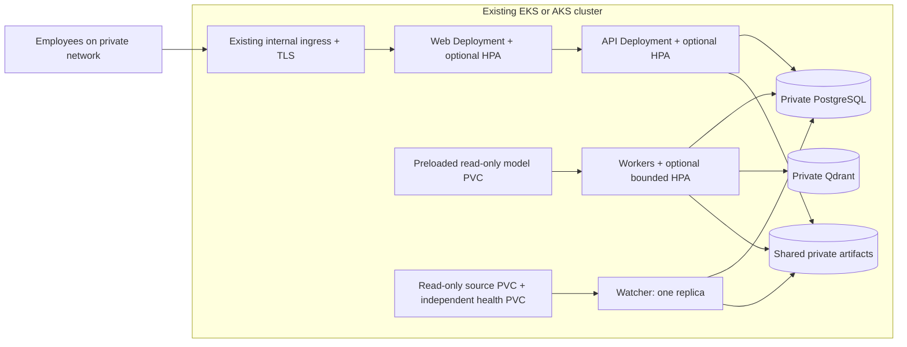

# AWS and Azure deployment

This package deploys the **current administration and automatic-ingestion
application**, not a finished question-answering product. It does not create
clusters, databases, Qdrant, volumes, cloud IAM, ingress controllers or secrets.
No cloud resources have been deployed or certified by these checks.

Use the [Helm chart](./helm/archers/Chart.yaml) directly, or manage that same chart
with [AWS Terraform](./terraform/aws/main.tf) or
[Azure Terraform](./terraform/azure/main.tf). Terraform uses an explicit existing
kubeconfig context; it does not request cloud administrator credentials.
The [packaging contract](../docs/deployment-packaging.md) owns deployment policy.

## What goes where



PostgreSQL and Qdrant may run outside the cluster on private endpoints.
Terraform only installs application Kubernetes resources through Helm.

## 1. Operator prerequisites

- A dedicated existing namespace, permission to create application resources
  and NetworkPolicies, and private access to the cluster API.
- A CNI that **enforces ingress and egress NetworkPolicies**. Verify this before
  loading documents; merely accepting NetworkPolicy YAML is insufficient.
  The chart supports RFC1918 IPv4 store destinations. Resolve private endpoint
  addresses into tightly scoped approved subnets; account for failover addresses.
  Pod/Service address translation and node-local DNS vary by CNI; test the actual
  paths. The default DNS selector assumes CoreDNS pods in `kube-system`.
  Node-local DNS needs a reviewed policy adaptation, not disabling the policy.
- Existing private PostgreSQL with `psycopg` connectivity and TLS verification,
  backups and enough connections for all application and other clients.
- Existing private Qdrant compatible with 1.15.5, dense/sparse vectors and
  persistent storage. The current adapter has **no API-key/client-certificate
  configuration**; use only a separately isolated trusted private service.
  Use trusted HTTPS where available. Do not use a public managed Qdrant endpoint
  or put credentials into the URL. This limitation blocks certification where
  authenticated vector connections are mandatory.
- Existing PVCs in the namespace:
  - Artifacts: shared POSIX filesystem, writable by UID/GID `10001`, with tested
    atomic rename, fsync, exclusive creation and no-symlink semantics. **All**
    API/watcher/worker pods see the same files, even at one replica per component.
    Multi-node operation needs `ReadWriteMany`, not separate node-local disks.
  - Model: checksum-verified embedding assets at the volume root, mounted
    read-only at `/models/embedding`. Concurrent workers on different nodes need
    shared readable storage. No model is downloaded at application startup.
  - Optional source: existing source folder mounted read-only into the watcher,
    with an operator-provisioned `.archers-source-id` UUID sentinel.
  - Optional source health: independently updated `inbox.json` at the volume
    root. Follow the [NAS health protocol](../docs/ingestion.md). A cached sentinel
    or a static `healthy: true` file is not a valid health check.
- Existing Secret `archers-runtime` (or your chosen name), containing keys
  `database-url`, `operator-token`, `signing-key`. Database URL must start with
  `postgresql+psycopg://`; use `sslmode=verify-full` with a trusted server
  certificate and trusted DNS name. Supply independently generated operator and
  signing secrets of at least 32 characters. Provision through your approved
  secret manager; **never place secret values in Helm/Terraform values or git**.
  Runtime secret rotation requires a controlled pod restart and session review.
- For ingress: an existing **internal-only** pod-based ingress controller,
  private DNS and trusted TLS Secret. Neither `Ingress` nor an annotation on it
  proves the controller's load balancer is private. These examples assume
  ingress-nginx with both namespace/pod selectors; other controllers, host
  networking or direct ALB/Application Gateway traffic need reviewed policy
  changes and connectivity tests.
- Worker nodes must support unprivileged Landlock and seccomp with the image's
  `libseccomp2`. Test under the actual container `RuntimeDefault` profile. The
  parser fails closed on unsupported kernels/policies; do not make pods
  privileged or disable the sandbox to bypass this.

AWS mappings: existing EKS, ECR image pull permissions, private PostgreSQL
(for example RDS), EFS CSI-backed shared artifacts/models/source.
Azure mappings: existing AKS, ACR image pull permissions, private PostgreSQL
Flexible Server and Azure Files **NFS** CSI-backed shared volumes.
These are operator-selected mappings, not provisioned or certified combinations.
Do not treat S3/Blob storage or an object-store FUSE mount as a drop-in POSIX
artifact backend. Source SMB/NFS permissions, credentials, encryption at rest,
backup retention and mount-health probes remain operator responsibilities.

## 2. Build images and prepare values

Build the existing images on an approved build host and push to your private
registry. Use the architecture supported by your worker nodes, not implicitly
the build laptop's architecture:

```bash
docker build -t YOUR_BACKEND_IMAGE ./backend
docker build -t YOUR_WEB_IMAGE ./web
docker push YOUR_BACKEND_IMAGE
docker push YOUR_WEB_IMAGE
```

Record the resulting registry digests. Copy
[AWS values](./helm/examples/aws-values.yaml) or
[Azure values](./helm/examples/azure-values.yaml) to a protected operator directory.
Replace the placeholder image repositories/digests, endpoints, CIDRs, claims,
Secret references, ingress selectors and hostname. The examples intentionally
fail until you confirm the controller is private by setting
`ingress.privateAccessConfirmed: true`. Ingress is disabled in chart defaults.
Keep the public application origin exactly `https://YOUR_PRIVATE_HOST` and TLS
cookies enabled. Do not expose the database, API or vector service publicly.

Explicitly prepare the pinned model on an approved staging host using
`archers download-model --directory YOUR_STAGING_DIRECTORY`, then populate the
model PVC with the verified assets, manifest and model card. Model preparation
has no access to company documents or runtime secrets.

The chart's single approved source alias is `inbox`. Disable `source.enabled`
if you only want manual ingestion. With folder ingestion enabled, register the
source once in the application using that alias and the existing sentinel UUID.
Do not run `source-init` against a live NAS volume to manufacture health evidence.

## 3. Connect to the existing cluster

Use approved short-lived credentials; never use downloaded admin certificates.
The CLI commands below update local kubeconfig, not cloud infrastructure:

```bash
# AWS; replace the cluster and region.
aws eks update-kubeconfig --name YOUR_EKS --region YOUR_REGION --alias archers-eks

# Azure; replace the resource group and cluster, and do not add --admin.
az aks get-credentials --resource-group YOUR_GROUP --name YOUR_AKS --context archers-aks
kubelogin convert-kubeconfig -l azurecli
```

Check the explicit context and namespace before every mutation. Commands below
use `archers-eks`; substitute `archers-aks` for Azure.

## 4. Gate migrations before application rollout

Back up existing data and quiesce application writes/workers for incompatible
changes. Only one operator may migrate at a time; the migration command is not
a distributed deployment lock. Do not start a parallel install/upgrade.

With Helm 3.19.0, render **only** the standalone migration resources. Do not turn
on `migration.enabled` in the application release's values.

```bash
helm lint deploy/helm/archers -f /absolute/private/path/values.yaml

helm template archers deploy/helm/archers --namespace archers \
  -f /absolute/private/path/values.yaml --set migration.enabled=true \
  --show-only templates/migration.yaml > /private/tmp/archers-migration.yaml
kubectl --context archers-eks --namespace archers apply \
  -f /private/tmp/archers-migration.yaml
kubectl --context archers-eks --namespace archers wait \
  --for=condition=complete job/archers-archers-migrate-0003-automatic-ingestion \
  --timeout=600s
```

This creates only a dedicated ConfigMap, deny-by-default NetworkPolicy and
migration Job; no application rollout occurs. If it fails, stop and inspect the
Job's safe error logs. `backoffLimit: 0` prevents silent retry loops.
Keep migration execution evidence. A failed Job must be investigated before
explicitly recreating that specific Job; never reset the database.
Future releases must use a new `migration.revision` Job suffix and the matching
schema compatibility gate. These files currently require schema
`0003_automatic_ingestion`.

## 5. Install using Helm OR Terraform

Do not have both tools independently manage the same Helm release. The namespace,
PVCs, runtime Secret and TLS Secret must already exist.

**Helm directly:**

```bash
helm upgrade --install archers deploy/helm/archers --namespace archers \
  --kube-context archers-eks -f /absolute/private/path/values.yaml \
  --atomic --wait --timeout 15m
```

**Terraform:** choose [aws](./terraform/aws/main.tf) or
[azure](./terraform/azure/main.tf), and copy its `terraform.tfvars.example` to a
private variables file. Set the exact existing context, namespace, absolute
values path and `migration_revision_applied = "0003_automatic_ingestion"` only
after the Job succeeds. This is an operator acknowledgement, **not** a database
check performed by Terraform. Supply a protected, encrypted and locked remote
state backend according to company policy before real use; none is silently
created. State/plan files may contain deployment metadata; do not commit them.

```bash
terraform -chdir=deploy/terraform/aws init
terraform -chdir=deploy/terraform/aws plan -var-file=/absolute/private/path/aws.tfvars
terraform -chdir=deploy/terraform/aws apply -var-file=/absolute/private/path/aws.tfvars
```

Use `deploy/terraform/azure` and the AKS context for Azure. Providers are pinned
and checksummed. Terraform installs the local chart with no namespace creation,
waits for the rollout, rejects automatic migration settings, and prevents
accidental release destruction. No cloud IAM credentials, model weights or
secret values are stored in the module inputs.

Initialize the first administrator interactively after installation:

```bash
kubectl --context archers-eks --namespace archers exec -it \
  deployment/archers-archers-api -- archers bootstrap \
  --username YOUR_ADMIN --company "YOUR_COMPANY"
```

Do not provide passwords on the command line. Bootstrap is one-time and refuses
an initialized installation. Verify private HTTPS login, source health, automatic
synthetic file ingestion, restart persistence and blocked unwanted egress before
using real documents. Pod readiness checks transport liveness after API schema
startup; **it does not assert RAG readiness**. The protected product readiness
endpoint intentionally remains 503 until query generation is implemented.
Worker/watcher process health is not proof of queue freshness: monitor job
failures, queue age and authenticated source status.

## Scaling and cost controls

Default: one API, web and worker; one watcher if a source is enabled.
The [experimental scaling overlay](./helm/examples/scaling-values.yaml) enables
CPU HPA for API/web/workers with min 1/max 2, slow one-pod steps and five-minute
scale-down stabilization. It requires Metrics Server, spare schedulable node
capacity and explicit shared-storage/uncertified-topology acknowledgements.
Terraform does not add node pools or configure a cluster autoscaler.

For Helm, append `-f deploy/helm/examples/scaling-values.yaml` to the application
command after reviewing the overlay. For Terraform, merge its settings into your
single operator-owned values file before planning. Do not enable autoscaling
merely to satisfy an acknowledgement flag.

- Set CPU/memory requests and limits after synthetic load tests. Every worker
  holds its own CPU embedding model and runs one job at a time; model RAM and
  database/vector/storage traffic increase with worker count.
- `scaling.workerReplicaLimit` caps declared worker replicas/HPA maximum. It is
  not a new database-wide semaphore or a cloud spending limit; do not run
  additional independent worker releases against the same installation.
- The chart conservatively budgets 15 PostgreSQL connections per API, worker,
  watcher and one migration process (SQLAlchemy's current default pool plus
  overflow). Give `scaling.databaseConnectionBudget` only the capacity remaining
  after administrative reserve and other clients. HPA maxima are included.
- Pending ingestion stays bounded by `application.maxPendingIngestionJobs`.
  CPU utilization is **not queue depth**; it may miss I/O-bound backlogs or
  misread startup cost. No KEDA/custom-metric scaling is claimed.
- Watcher remains one replica. Existing PostgreSQL claim/lease fencing preserves
  job correctness across workers, but large scans serialize tenant mutations;
  increasing scanner replicas would not fix this bottleneck.
- PDBs and preferred node anti-affinity are emitted for scaled workloads.
  Rollouts intentionally use `Recreate` to avoid extra model/process replicas
  outside the stated budget, so deployments can experience downtime.
  A PDB is not HA or a drain protocol. Worker termination may abandon a lease;
  publication stays fenced, but retry limits can require operator intervention.
- PostgreSQL/Qdrant HA, backups, node autoscaling and disaster recovery remain
  operator-owned. More pods do not make these dependencies highly available.
- No paid models, hosted traces, runtime model downloads or generation GPU
  services are enabled by this package. This is not a full RAG scaling benchmark.

Before production, test concurrent uploads and replacements, interrupted jobs,
stale mounts, unavailable stores, denied internet/metadata traffic, node moves,
populated upgrades and isolated restore. Static validation cannot certify
cloud, NAS filesystem semantics or the Linux parser sandbox.

## Upgrades and removal

Pin a tested application image pair and chart revision. Review schema
compatibility, take a consistent backup and run the standalone migration gate
before the compatible rollout. Terraform hashes chart contents so template edits
also produce release updates. Application rollback is **not** database rollback.
Never downgrade schema or delete customer volumes to make an upgrade succeed.

Terraform's `prevent_destroy` intentionally blocks release removal. After an
approved backup and shutdown plan, an operator may explicitly remove that guard
in a reviewed change. Helm uninstall removes application resources, not the
operator-managed PVCs, databases or Secrets. Standalone migration resources are
not Helm-managed and must be retained for audit or cleaned up explicitly by name.
Credential revocation, source offboarding and data erasure are separate actions.

## Reproducible offline checks

Validated tooling: Helm 3.19.0, Terraform 1.13.5, Helm provider 2.17.0,
kubeconform 0.7.0 against Kubernetes 1.33.0 schemas. These versions are validation
inputs, not an EKS/AKS support or certification matrix.

```bash
backend/.venv/bin/python -m pytest deploy/tests/test_helm.py -q
terraform fmt -check -recursive deploy/terraform
terraform -chdir=deploy/terraform/aws init -backend=false
terraform -chdir=deploy/terraform/aws validate
terraform -chdir=deploy/terraform/azure init -backend=false
terraform -chdir=deploy/terraform/azure validate
terraform -chdir=deploy/terraform/modules/archers init -backend=false
terraform -chdir=deploy/terraform/modules/archers test
```

The chart tests need `helm` and `kubeconform` on PATH (or `HELM_BIN` and
`KUBECONFORM_BIN`). Provider/schema initialization may need internet access or
operator-prepared caches; none of these tests needs a cluster or cloud login.
Only public schemas/providers are downloaded; fixtures are synthetic.
